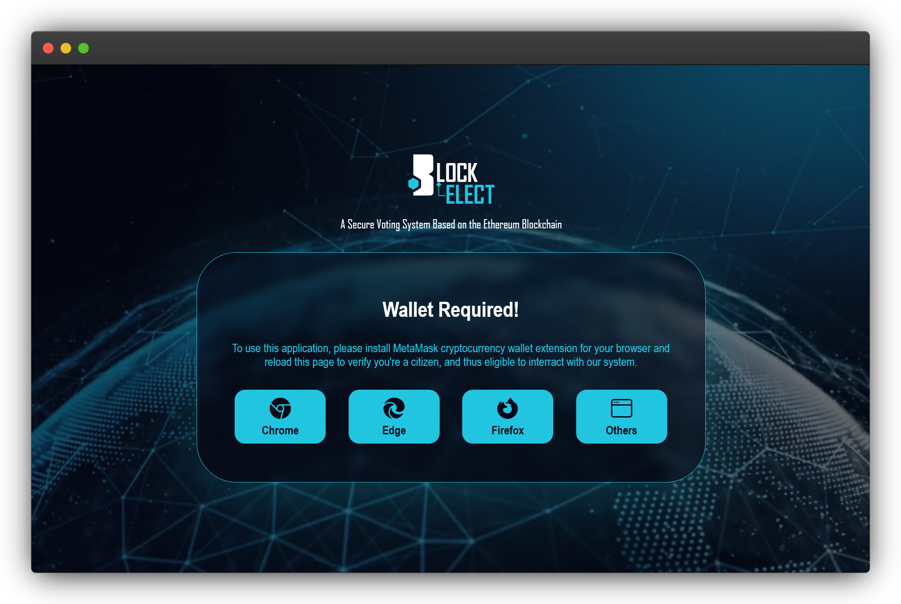
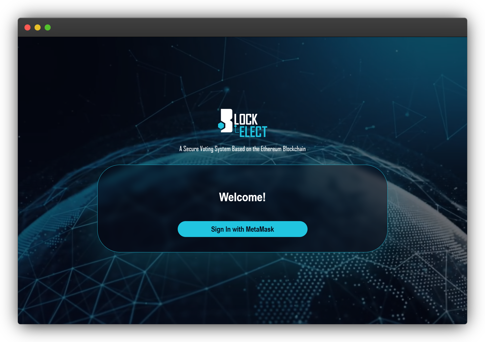
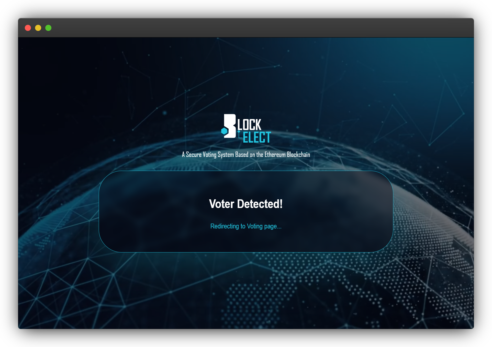
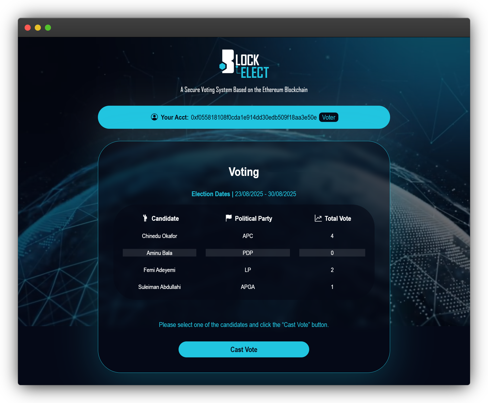
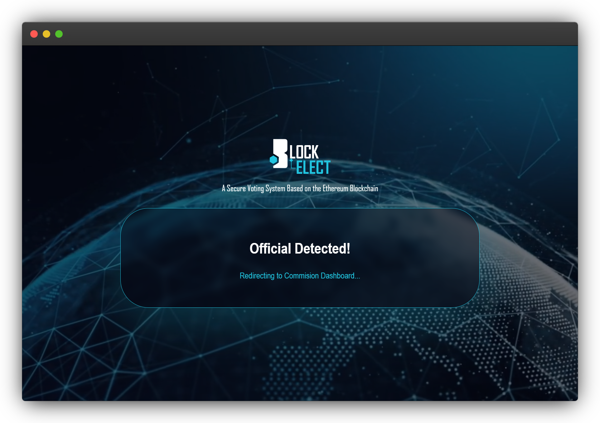
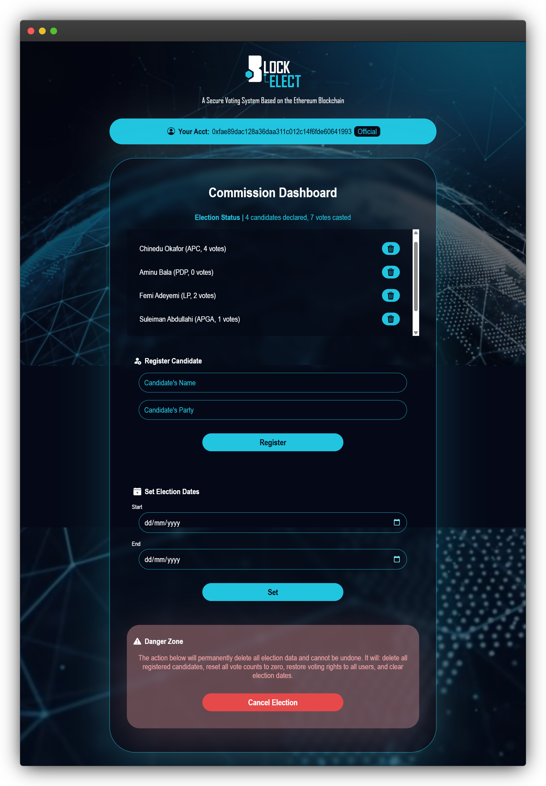

# BLOCKELECT: Blockchain-Based Secure Voting System

<p align="center">
  
</p>

## Original Project and Attribution

**This project is based on BLOCKELECT: Blockchain-Based Secure Voting System**, originally developed by **Samuel A. Ughili and Joshua U. Ngwuoke** as a final-year project at the Department of Computer Science, Plateau State University, Bokkos.

- **Original repository:** [BLOCKELECT — Blockchain-Based Secure Voting System](https://github.com/samughili/BLOCKELECT-Blockchain-Based-Secure-Voting-System)
- **Published thesis:** [Research thesis (DOI)](https://doi.org/10.6084/m9.figshare.31249816)
- **Original license:** MIT License

The original authors retain their copyright to their contributions. This repository incorporates or derives from their original work. Any modifications and additional contributions by S K Ismail should be distinguished from the original authors' work.

This project is shared in accordance with the MIT License, including its copyright and permission notice requirements. Please consult the original repository and thesis for the original implementation and research.

## 🛠️ Tech Stack


## ✨ Key Features

- **Voter authentication:** Web3 wallet-based voter address verification.
- **Smart contracts:** Ethereum smart contracts for enforcing voting rules and recording votes.
- **Blockchain transparency:** On-chain transactions that can be audited.
- **Electoral commission dashboard:** Interface for election administration and monitoring.
- **Voting interface:** Candidate information and voting interactions with blockchain feedback.
- **Vote integrity:** Designed to prevent duplicate voting and unauthorized vote modification through contract-enforced rules.

> Actual security properties depend on the smart contract implementation, deployment configuration and testing. Do not treat the feature descriptions as an independent security audit.

## 💡 Abstract

Traditional electoral systems can face vulnerabilities involving vote manipulation, centralized points of failure and insufficient transparency. BLOCKELECT explores a decentralized blockchain-based voting system intended to address these challenges. It uses Ethereum smart contracts written in Solidity, Web3.js for blockchain integration and MetaMask for wallet-based voter verification. The system includes interfaces for voters and electoral commission personnel, with blockchain transactions providing a transparent and auditable record of voting activity.

The original project describes an implementation using the Truffle development framework, Ganache blockchain simulation and Node.js backend services. Its goal is to improve the integrity, transparency and auditability of electronic elections.

For the original research methodology, implementation details and findings, refer to the [published thesis](https://doi.org/10.6084/m9.figshare.31249816).

## ⚙️ Functional Overview

- Web3 wallet authentication for voter address verification.
- Ethereum smart contracts for on-chain voting operations.
- Blockchain-based recording of voting transactions.
- Electoral commission interface for election administration.
- Candidate information and voting interface.
- Blockchain transaction feedback to help users follow voting operations.

## 🛠️ Requirements

The following versions are documented for this project. Verify compatibility with the dependencies in `package.json` and the installed development environment before deployment.

- Node.js: `v22.14.0`
- Web3.js: `v1.10.0`
- Express.js: `v4.17.14`
- Solidity: `v0.8.19` (solc-js)
- Truffle: `v5.11.5`
- Ganache GUI: `v2.7.1` or Ganache CLI `v7.9.1`
- MetaMask: `v13.1.0`
- ESBuild: `v0.25.9` or a compatible JavaScript bundling tool

### Getting Started

1. Install Node.js and npm.
2. Clone or download this repository.
3. Install the dependencies listed in `package.json`:

   ```bash
   npm install
   ```

4. Review `truffle-config.js` and configure the local blockchain network.
5. Start Ganache or another compatible development network.
6. Compile and deploy the smart contracts using the project's configured Truffle scripts.
7. Configure the application to connect to the deployed contract and the intended blockchain network.
8. Start the application using the scripts defined in `package.json`.

**Note:** The exact commands for compiling, deploying and starting the application depend on the scripts and network configuration in your checked-out version. Review those files before running deployment commands.

## 📱 Screenshots

### Wallet Required


### Sign In


### Voter Detection


### Voting Page


### Official Detection


### Electoral Commission Dashboard


## 📂 Project Structure

The following structure reflects the project layout documented for this repository. Some generated directories may be created only after installing dependencies or building the application.

```text
BLOCKELECT/
├── build/
│   └── contracts/
│       └── VotingSys.json
├── contracts/
│   └── VotingSys.sol
├── dist/
│   └── app.bundle.js
├── migrations/
│   └── 1_deploy_contracts.js
├── src/
│   ├── assets/
│   ├── css/
│   ├── icons/
│   ├── js/
│   ├── sounds/
│   ├── index.html
│   └── official.html
├── views/
│   ├── commission_dashboard.png
│   ├── official_detected.png
│   ├── sign_in.png
│   ├── voter_detected.png
│   ├── voting.png
│   └── wallet_required.png
├── LICENSE
├── package-lock.json
├── package.json
├── README.md
├── server.js
└── truffle-config.js
```

## 📄 License

This project is distributed under the MIT License, subject to the terms and notices in the [`LICENSE`](./LICENSE) file.

The original copyright notice for Samuel A. Ughili and Joshua U. Ngwuoke must remain preserved. Any additional copyright notice should apply only to your own original modifications and must not imply ownership of the original authors' work.

## 🙏 Acknowledgments

Credit and thanks to **Samuel A. Ughili and Joshua U. Ngwuoke** for their original BLOCKELECT project and research.

- [Original BLOCKELECT repository](https://github.com/samughili/BLOCKELECT-Blockchain-Based-Secure-Voting-System)
- [Published research thesis](https://doi.org/10.6084/m9.figshare.31249816)
